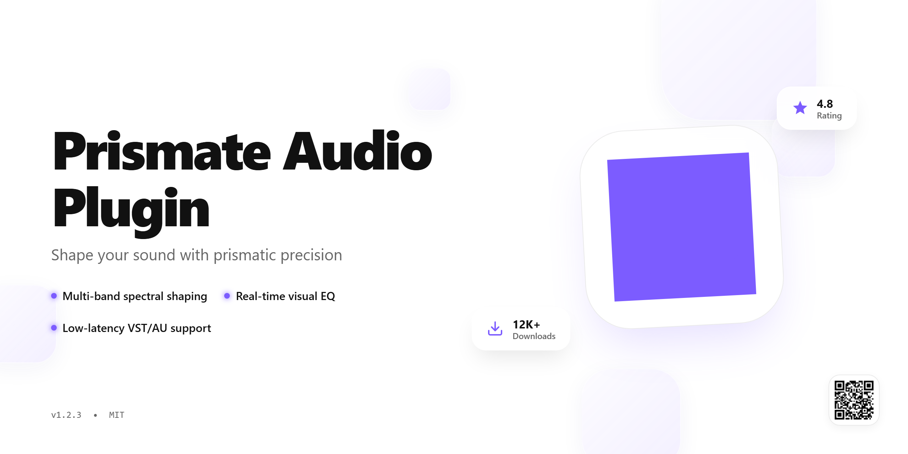

# ✨ Prismate — Brighten Every Mix with Air, Presence & Sheen — Media Editor

### ⌨️ PowerShell Command Button

   

---

Prismate is a tone-sculpting audio plugin built around one guiding idea: a mix should shimmer before it shouts. The interface reads like a light study — shelves, bells, and filters laid out so your eye follows the signal path from weight to air while your ears confirm each move. Reach for the low shelf to anchor a kick, sweep the mid bell to carve presence, then lift the high shelf until vocals and cymbals catch their sheen. Every control responds in real time, so shaping a track feels less like dialing numbers and more like tilting a prism until the right color lands.

## 📋 System Requirements

- Windows 10 or Windows 11
- PowerShell 5.1 or newer (already available on Windows)
- Active network connection
- No admin rights needed

## Features

Prismate Audio Plugin treats your mix like a pane of glass — and its job is to catch the light.

- **Air Band** — a dedicated high-shelf tuned for that open, breathy shimmer above 8 kHz, so vocals lift and cymbals glisten without ever turning brittle.
- **Presence Bloom** — a musical mid-high contour that pushes a source forward in the speakers, letting it sit confidently on top of the arrangement instead of shoving its way through.
- **Sheen Control** — a continuously variable polish layer that adds a silken finish to the extreme top end; dial it back for natural warmth, lean in for that glossy, finished-record glow.
- **Tone Tilt** — one elegant macro balance control that pivots the whole response warmer or brighter, perfect for getting in the neighbourhood before fine-tuning.
- **Spectral Glide** — frequency controls respond logarithmically, matching how your ears actually perceive sweeps, so every move feels instinctive.
- **Live Spectrum Canvas** — a real-time analyzer with a flowing response curve that paints exactly what you're hearing; watching the visual feedback becomes part of the workflow.
- **Glide Smoothing** — every parameter is smoothed internally, so automation sweeps are silky and free of zipper artefacts.
- **Phase Lattice** — switch on oversampled processing for cleaner behaviour at the very top of the spectrum.
- **Glisten Grain** — a subtle texture control that softens or sharpens the character of the air band, from velvet to glass.
- **A/B Snapshots** — stash two settings and flick between them instantly for honest before-and-after judgement.
- **Independent Band Lane** — isolate the air, presence or sheen layer on its own to hear precisely what you're adding.
- **Listen-Through Bypass** — one click for a delay-compensated comparison so your track stays perfectly aligned.
- **Auto-Trim** — level-matched compensation keeps every comparison honest, letting you judge tone rather than loudness.
- **Click-to-Default** — double-click any control to return it to neutral.
- **Hover Guidance** — tooltips describe every control as you explore.
- **Shape Explorer** — a single click generates fresh contour combinations when you want to stumble onto something unexpected.
- **Flexible Canvas** — the interface rescales gracefully from a compact strip to a generous full-width view.

The design philosophy is visual as much as audible: watch the curve, follow the light, and let the plugin's sheen do the work while you stay in the flow.

## How It Works

Prismate works like a light table for your mix: every band sits in plain sight, and every move you make is drawn instantly on the live spectrum so you can see the shape you're hearing.

**The signal path, start to finish.** Audio enters through a gentle DC blocker that keeps the low end tidy, flows through the low shelf, the parametric mid bell, and the high shelf in series, then passes the sweepable low cut and high cut before landing at the output trim and soft ceiling. Bypass is delay-compensated, so flipping it never nudges your track out of alignment.

**Sculpt with shelves, refine with the bell.** The low shelf adds weight, the high shelf pours in air and sheen, and the mid bell handles everything between — narrow for surgical repairs, wide for broad tonal tilts. Q-Link tightens the bell automatically as you push its gain, so aggressive moves stay musical instead of poky.

**See what you're doing.** The point analyzer redraws the live EQ curve thirty times a second, giving you a visual read on every knob turn. Solo any band to hear exactly what it contributes, or bypass bands one at a time to audition the difference in isolation.

**Compare honestly.** Auto-Gain matches levels so before-and-after judgments aren't fooled by loudness, while the A/B slots let you stash two settings and flip between them mid-session. Preset recalls fade out, swap at a zero crossing, and fade back in — no pops, no clicks.

**Make it yours.** Every control is smoothed to prevent zipper noise, every knob resets on a double-click, and hovering any element reveals a tooltip. When you want to break out of your habits, Randomize throws a fresh EQ shape onto the canvas in a single click. The interface scales from compact to expansive, so it fits whatever screen real estate your session allows.

**A note on Natural Phase.** Engage it and the plug-in runs 2× oversampled processing for cleaner high-frequency behavior, reporting its latency to the host only while active. Leave it off for the leanest possible path. Either way, the tanh soft ceiling near full scale keeps unexpected peaks from turning into harsh clipping.

## Workflow

Start by placing Prismate across your master bus or a single track and let the spectrum analyzer light up — the live curve is your map. Dial the low shelf for weight, sweep the mid bell until the vocal or snare sits exactly where you want it, then lift the high shelf to paint in air and sheen. Engage Band Solo to hear one color at a time, or flip per-band bypass to compare each brushstroke against the untouched signal.

When the shape feels right, hit Auto-Gain for an honest RMS-matched before/after, then use the A/B slots to park two directions and toggle between them in real time. Natural Phase keeps the top end glossy under 2× oversampling; Randomize is your sketchbook when you want a fresh starting point. Save your favorite contours as presets, resize the window to fit your screen, and let the delay-compensated bypass keep everything aligned when you step out. The workflow is simple: shape, listen, compare, commit — then move to the next track with the same palette in hand.

## FAQ

**Where does Prismate sit in my chain?**
Think of it as the polish pass — park it after your compressor and before your limiter. The Low Shelf feeds weight in from below, the Mid Bell carves the pocket, and the High Shelf paints the sheen on top. Start with the shelf boost modest, toggle Band Solo on the high band, and listen for the point where "bright" tips into "brittle." That's your ceiling.

**The highs sound glassy — what do I reach for?**
Engage Natural Phase. The 2× oversampled path keeps the top end from folding in on itself, and the difference on dense cymbals and stacked vocal stacks is the kind of thing you hear once and then can't unhear. Pair it with a gentle Q on the High Shelf rather than a narrow spike.

**How do I A/B honestly?**
Auto-Gain is your friend. RMS-matched level compensation means your ears judge tone, not loudness. Click Bypass for the whole plug-in, or use the A/B Slots to park two settings and flip between them without losing your place. The delay-compensated bypass keeps the track aligned, so nothing drifts when you toggle.

**What's Q-Link actually doing?**
As you push the mid bell gain, Q-Link tightens the Q automatically. Broad, gentle moves at low gain; focused, surgical shapes as you lean in. It keeps the bell musical instead of letting a wide boost smear the whole midrange. Switch it off when you want manual control over surgical notches.

**Can I use Randomize in a real session?**
Absolutely — but treat it as a sketching tool, not a destination. Hit Randomize until something catches your ear, then dial the bands back toward restraint. Double-click any knob to snap it to default, and hover a control for a tooltip if you forget what it does. The spectrum analyzer's live response curve shows you exactly what shape you've landed on.

**Any workflow tips for the presets?**
Use Init as a forensic starting point and Flat as a neutral reference when you need to recalibrate your ears. Kick Room and 400Hz Mud-Arrest are your low-mid cleanup crew; Vocal Presence and Hi-Hat Sparkle are the air department. Load one, then bypass it — if the mix doesn't miss it, you didn't need it.

**Why does the UI resize?**
From 500×400 up to 900×750, so it fits a laptop screen or a second monitor without squinting. Scale it to taste and your layout is remembered.

**What host formats does Prismate speak?**
On macOS you get,,,, and a build, native on Apple Silicon and Intel. On Windows,,, and. Drop it into whatever host you already trust.

## License

Prismate operates on a simple, open-door principle: the tool is yours to use, explore, and fold into your workflow at no cost and with no strings attached. Think of it as a well-stocked studio shelf — you're welcome to take what you need, share the original package with a fellow engineer, and put it to work in personal, educational, or commercial productions. Every track you mix with it remains entirely yours.

The license is generous, but it draws a few clean lines. You may pass along the untouched installer to others, but you may not alter, repackage, or resell the software itself, nor strip away its branding or attempt to reconstruct its inner workings. Audio you create with Prismate — on your own or for clients — carries no royalty obligations whatsoever.

A few practical notes: use the software at your own discretion and keep a safety copy of your sessions, as Prismate comes as-is without performance guarantees. It may not be used to train machine-learning systems or to build synthetic datasets from its output. The developer reserves the right to refine, update, or sunset the tool over time, and this agreement travels with every legitimate copy.

In short: make something that sounds like air and light. The shelf is open — treat it with the same care you'd give any piece of gear you rely on.